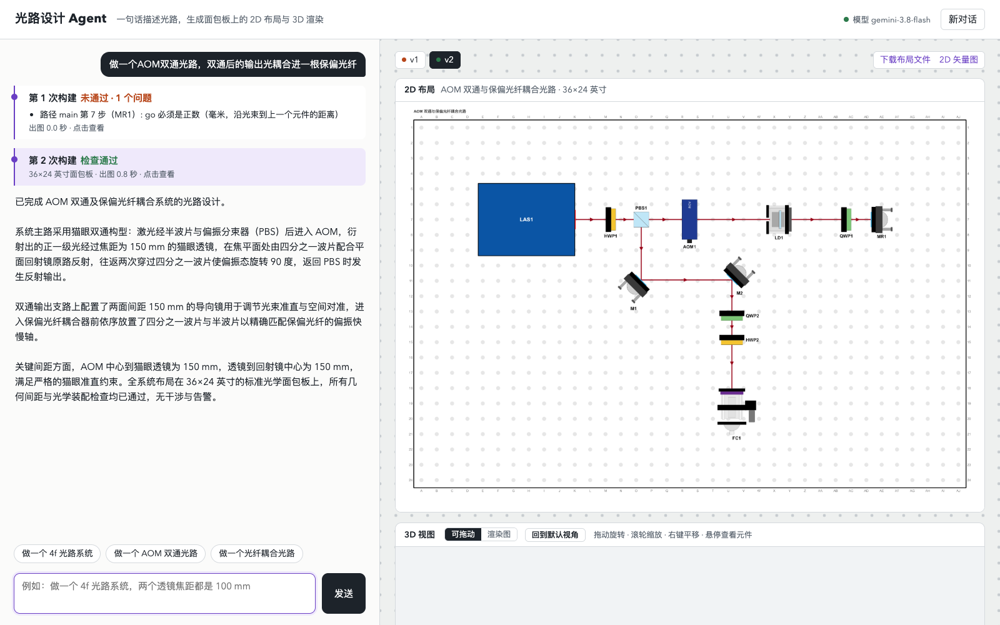
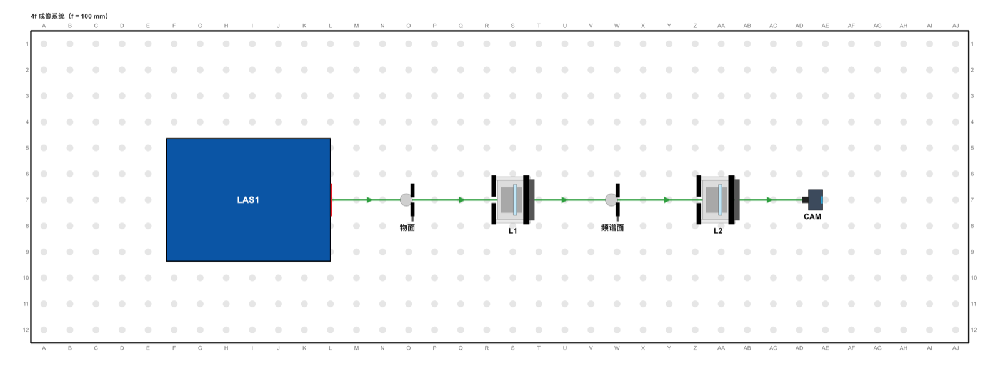
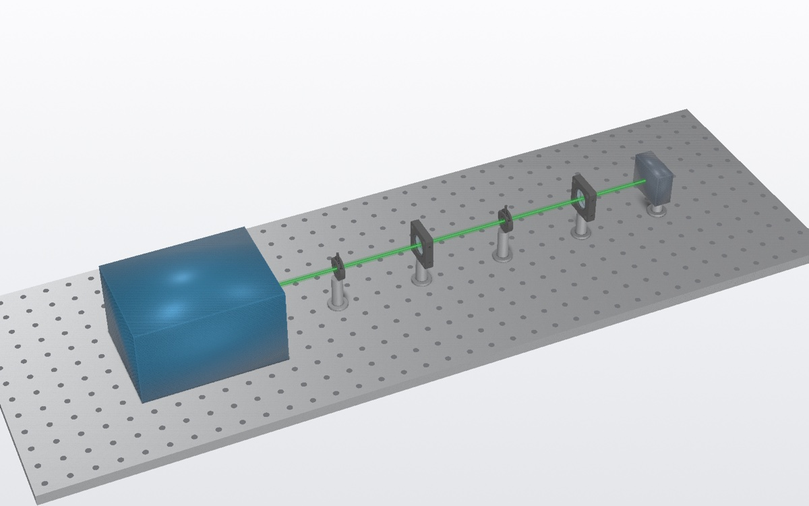
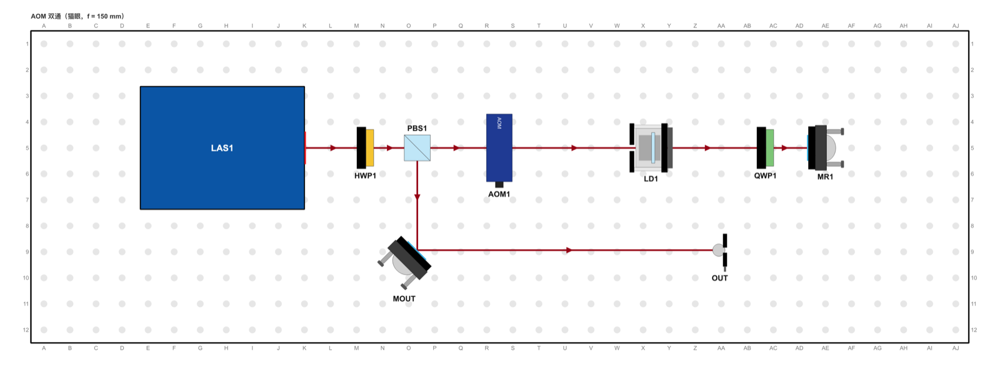
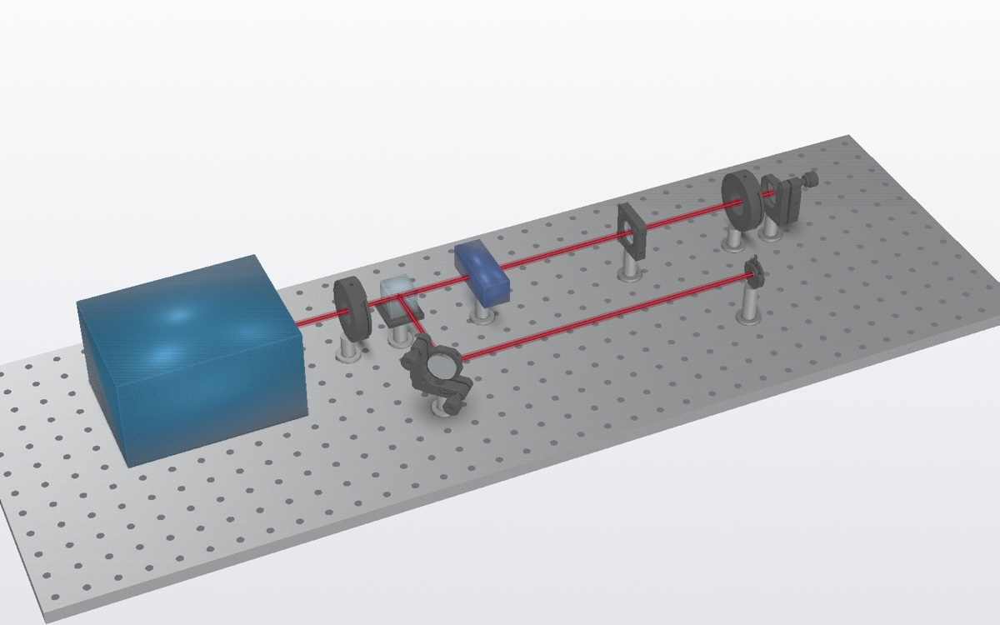
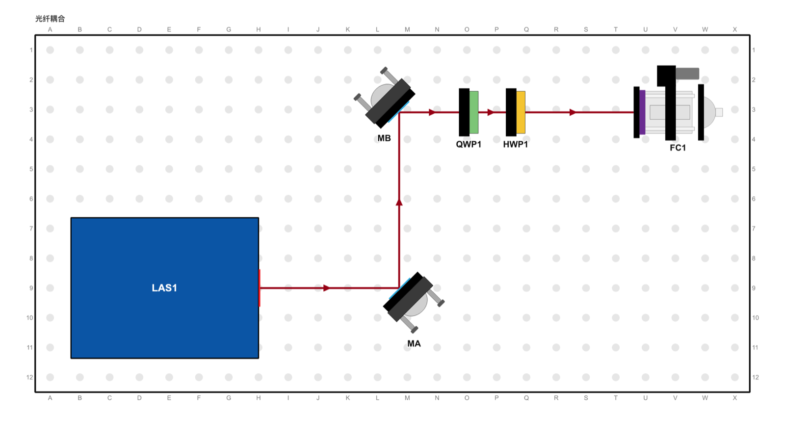
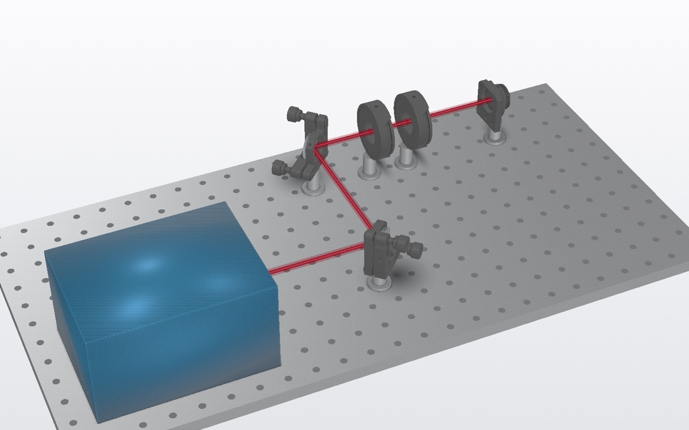
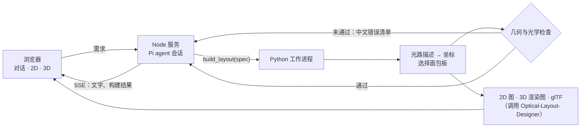

<h1 align="center">光路设计 Agent</h1>

<p align="center">
  用一句话描述光路，得到一块可以照着搭的光学面包板：2D 布局图、可拖动的 3D 视图，以及能直接打开编辑的布局文件。
</p>

<p align="center">
  
  
  
  
  
  <a href="LICENSE"></a>
</p>

<p align="center">
  
</p>

<p align="center"><sub>真实运行截图：第一次提交漏写了回射镜的距离，被检查拦下；agent 读取错误后自行修正，第二次通过。</sub></p>

---

## 特性

- **一句话出图**：「做一个 4f 光路系统」「AOM 双通」「光纤耦合」，以及它们的组合，几秒到十几秒就能得到完整布局。
- **模型不碰坐标**：模型只写沿光束走的「光路描述」，坐标、镜子角度和面包板尺寸都由程序计算，透镜间距不会因为模型算错而出错。
- **自动检查，自我修正**：几何干涉和光学规则（4f 间距、猫眼双通、光纤导向镜）逐条检查，失败原因用中文点名元件返回给模型，模型修正后重试。
- **多轮修改**：可以追问「焦距改成 150 mm」「在频谱面加一个光阑」，每次构建都会保存为一个版本，可以和上一版并排对比。
- **可拖动的 3D 视图**：旋转、缩放、平移，鼠标悬停时显示元件名和焦距；也可以切换到离屏渲染的静态图。
- **与上游项目兼容**：生成的 `layout.json` 可以直接用 [Optical-Layout-Designer](https://github.com/FrankLyu/Optical-Layout-Designer) 打开，继续调整、导出物料清单或记录功率。
- **离线兜底**：内置三个已校验的示例，不调用模型也能演示出图。

## 效果

下面的图都由 `examples/specs/` 中的描述自动生成，没有经过手工调整。

<table>
  <tr>
    <th width="16%">需求</th>
    <th width="46%">2D 布局</th>
    <th width="38%">3D 渲染</th>
  </tr>
  <tr>
    <td><b>4f 成像系统</b><br><sub>f = 100 mm，物面、频谱面、像面依次相距 f</sub></td>
    <td></td>
    <td></td>
  </tr>
  <tr>
    <td><b>AOM 双通</b><br><sub>猫眼结构 f = 150 mm，返回光从 PBS 另一端输出</sub></td>
    <td></td>
    <td></td>
  </tr>
  <tr>
    <td><b>保偏光纤耦合</b><br><sub>两面导向镜 + QWP/HWP 偏振对准</sub></td>
    <td></td>
    <td></td>
  </tr>
</table>

## 快速开始

### 环境要求

- Python 3.13
- Node.js 22.19 或更高
- 一个 OpenAI 兼容的大模型接口（模型需要支持工具调用）
- [Optical-Layout-Designer](https://github.com/FrankLyu/Optical-Layout-Designer)：作为依赖库使用，默认放在本项目的同级目录

```text
LLMs/
├── Optical-Layout-Designer/     # 上游项目，不需要修改
└── optical-designer-agent/      # 本项目
```

### 安装

```bash
git clone https://github.com/FrankLyu/Optical-Layout-Designer.git
git clone https://github.com/edc3000/optical-designer-agent.git
cd optical-designer-agent

python3.13 -m venv .venv
.venv/bin/pip install -r py/requirements.txt
npm install
```

### 配置

```bash
cp .env.example .env
```

| 变量 | 必填 | 说明 |
|---|---|---|
| `OPTAGENT_BASE_URL` | 是 | OpenAI 兼容接口地址，例如 `https://api.example.com/v1` |
| `OPTAGENT_API_KEY` | 是 | 接口密钥 |
| `OPTAGENT_MODEL` | 是 | 模型 ID |
| `OPTAGENT_REASONING` | 否 | 模型支持推理模式时设为 `true`，默认 `false` |
| `OPTAGENT_CONTEXT_WINDOW` | 否 | 上下文长度，默认 `128000` |
| `OPTAGENT_MAX_TOKENS` | 否 | 单次最大输出，默认 `8192` |
| `PORT` | 否 | 服务端口，默认 `8787` |
| `OPTOLAYOUT_ROOT` | 否 | Optical-Layout-Designer 的位置，默认 `../Optical-Layout-Designer` |

### 运行

```bash
npm start
```

打开 <http://127.0.0.1:8787>，输入需求，或点击输入框上方的示例。

## 使用

**提需求。** 用自然语言描述就行，可以带上参数：

```text
做一个 4f 光路系统，两个透镜焦距都是 100 mm
做一个 AOM 双通光路，双通后的输出光耦合进一根保偏光纤
在 24×12 英寸的板子上做一个光纤耦合光路，波长 780 nm
```

**追问修改。** 在同一个对话里继续说「把两个透镜焦距都改成 150 mm」，agent 会在上一版的基础上修改。右侧勾选「与上一个通过的版本对比」，可以把两版并排查看。

**查看结果。** 对话中的每次构建都会显示为一张卡片，写明是否通过和具体问题，点击卡片可以切换到对应版本。右侧的「元件位置与光程」列出每个元件所在的孔位和相邻元件间的距离，展开后还能看到 agent 提交的原始光路描述。

**继续编辑。** 点击「下载布局文件」得到 `layout.json`，然后用上游的桌面程序打开：

```bash
cd ../Optical-Layout-Designer
python run.py ~/Downloads/layout.json
```

**没有模型时演示。** 页面右侧的「加载示例」按钮直接构建三个已校验的示例，不调用模型。

## 工作原理

### 架构



- **Node 服务**（`server/`）：每个浏览器对话对应一个 [Pi](https://github.com/earendil-works/pi) agent 会话。会话里关掉了读写文件、执行 shell 等内置工具，只注册一个 `build_layout` 工具。agent 的文字输出和每次构建结果都通过 SSE 实时推送到页面。
- **Python 工作进程**（`py/optagent/`）：常驻进程，通过 stdin/stdout 用 JSON 行与 Node 通信，这样 Qt 和 pyvista 只需加载一次。它把光路描述转换成上游项目的布局格式，运行检查并出图。
- **出图**：直接复用上游项目的代码。2D 图用桌面程序自己的导出功能，所以和桌面程序里看到的一致；3D 图用它的 pyvista 场景离屏渲染，并额外导出一份 glTF 给网页的 three.js 查看器。

### 光路描述

模型提交的 `spec` 描述的是「沿着光束走」，不包含坐标：

```json
{
  "title": "4f 成像系统（f = 100 mm）",
  "wavelength_nm": 532,
  "paths": [
    { "id": "main", "dir": 0, "steps": [
      { "part": "laser", "label": "LAS1" },
      { "go": 80,  "part": "iris", "label": "物面" },
      { "go": 100, "part": "lens", "label": "L1", "f": 100 },
      { "go": 100, "part": "iris", "label": "频谱面" },
      { "go": 100, "part": "lens", "label": "L2", "f": 100 },
      { "go": 100, "part": "photodiode", "label": "CAM" }
    ]}
  ],
  "constraints": [{ "type": "distance", "a": "L1", "b": "L2", "mm": 200 }]
}
```

| 字段 | 含义 |
|---|---|
| `dir` | 第一条路径的出射方向，单位度：0 向右，90 向上 |
| `go` | 沿光束到上一个元件的距离（mm） |
| `part` | `laser` `mirror` `lens` `hwp` `qwp` `pbs` `bs` `aom` `iris` `fiber` `shutter` `dump` `photodiode` |
| `turn` | 仅用于 `mirror`：`left` / `right` 表示转 90°，`back` 表示回射镜 |
| `from` + `turn` | 从某个 `pbs` / `bs` 分出一条支路，比如 PBS 的反射光或双通的返回光 |
| `f` | 透镜焦距（mm），`lens` 必填 |
| `constraints` | 模型声明的光程要求，由程序核对 |

程序会：
1. 按描述计算每个元件的坐标；
2. 按元件实际朝向估算占地，挑选能放下的最小标准面包板；
3. 把第一个元件对齐到螺丝孔；
4. 生成上游格式的原理图和布局，镜子角度交给上游的自动转角功能计算。

### 检查规则

| 类别 | 规则 | 不通过时返回给模型的信息（示例） |
|---|---|---|
| 几何 | 元件外形不能重叠；支杆底座中心至少相距 25 mm | `元件太近：物面 与 L1 中心相距 8 mm，支杆底座约需 25 mm，请拉开` |
| 几何 | 光束不能穿过不在这条光束上的元件 | `光束 MX→BD 穿过了 AOM1，请改变路径或移动元件` |
| 4f / 望远镜 | 相邻两个透镜的光程等于 f1 + f2 | `透镜 L1(f=100) 与 L2(f=100) 光程 220.0 mm，不等于 f1+f2 = 200 mm` |
| AOM 双通 | 猫眼透镜在 AOM 后 f 处，回射镜在透镜后 f 处 | `双通 AOM1：猫眼透镜 LD1 应在 AOM 后 f = 150 mm，现在是 120.0 mm` |
| AOM 双通 | AOM 与回射镜之间有 QWP；AOM 前有 PBS，返回光有出射支路 | `双通 AOM1：缺少返回光的出射路径，请加一条 from="PBS1" 的支路` |
| 光纤耦合 | 每个耦合器之前有两面独立的导向镜 | `光纤 FC1：耦合前需要两面独立的导向镜，现在只有 1 面` |
| 约束 | 模型声明的光程误差不超过 1 mm | `约束 2：L1→L2 光程应为 200 mm，实际 220.0 mm` |
| 描述 | 元件类型、标签唯一、焦距、转向是否合法 | `路径 main 第 7 步（MR1）: go 必须是正数` |

## 开发

### 项目结构

```text
optical-designer-agent/
├── server/                 # Node 服务（TypeScript，tsx 直接运行）
│   ├── agent.ts            #   Pi 会话、模型接入、build_layout 工具
│   ├── prompt.ts           #   系统提示词：描述写法、光学规则、参考示例
│   ├── index.ts            #   HTTP、SSE、静态文件与示例接口
│   ├── worker.ts           #   Python 工作进程的桥接
│   └── mock_llm.ts         #   测试用的模拟 OpenAI 接口
├── py/optagent/            # Python 工具
│   ├── spec.py             #   光路描述 → 坐标 → 面包板 → 上游布局格式
│   ├── checks.py           #   几何与光学检查
│   ├── render.py           #   2D/3D 出图与 glTF 导出
│   ├── pipeline.py         #   一次完整构建
│   ├── worker.py           #   常驻进程（JSON 行协议）
│   └── cli.py              #   命令行构建，便于调试
├── web/                    # 页面（原生 HTML/CSS/JS，无构建步骤）
│   └── viewer.js           #   three.js 3D 查看器
├── examples/specs/         # 已校验的示例描述
└── py/tests/               # pytest
```

### 测试

```bash
cd py && ../.venv/bin/python -m pytest -q   # 示例能通过检查，常见错误能被识别
npx tsc --noEmit                             # 服务端类型检查
```

在命令行里构建单个描述，同时输出摘要、错误和图片：

```bash
cd py && ../.venv/bin/python -m optagent.cli ../examples/specs/dp_aom.json /tmp/out
```

### 不用真实模型调试 agent 循环

`server/mock_llm.ts` 是一个模拟的 OpenAI 兼容接口：它第一次故意提交一个透镜间距写错的 4f 描述，收到检查报错后再提交修正版。用它可以完整走一遍「出错 → 修正 → 通过」的流程。

```bash
npx tsx server/mock_llm.ts &
OPTAGENT_BASE_URL=http://127.0.0.1:8790/v1 OPTAGENT_API_KEY=mock OPTAGENT_MODEL=mock npm start
```

### 添加一条光学规则

1. 在 `py/optagent/checks.py` 的 `optics()` 里加检查，错误信息写成能让模型照着改的一句话，并点名相关元件。
2. 在 `py/tests/test_pipeline.py` 里加一个故意违反这条规则的用例。
3. 在 `server/prompt.ts` 的「必须遵守的光学与装配规则」里写明这条规则，让模型第一次就尽量写对。

## 局限与路线图

- [ ] 只支持 1 英寸孔距面包板，元件装在支杆上。上游支持的 Olego、LightFlow、PyOpticL 板型还没有接入。
- [ ] 不做光线追迹和高斯光束传播计算，光学正确性靠规则检查保证。
- [ ] 元件仅限上游元件库中的类型，相机暂时用探测器的符号代替。
- [ ] 3D 视图只能查看，不能拖动元件来编辑布局。
- [ ] 让模型看到渲染出的 2D 图片，用视觉信息自查布局。

## 致谢

- [Optical-Layout-Designer](https://github.com/FrankLyu/Optical-Layout-Designer)（Jiahao Lyu，MIT License）提供布局格式、2D 绘制、自动转角和 3D 模型。3D 视图中使用的厂商网格版权归各制造商所有，详见上游项目说明。
- [Pi](https://github.com/earendil-works/pi) 提供 agent 运行框架。
- [three.js](https://threejs.org/) 提供浏览器端 3D 显示。

## 许可证

本项目代码以 [MIT License](LICENSE) 发布。运行时依赖的上游项目及其中的厂商 3D 网格遵循各自的许可，本仓库不包含这些文件。
